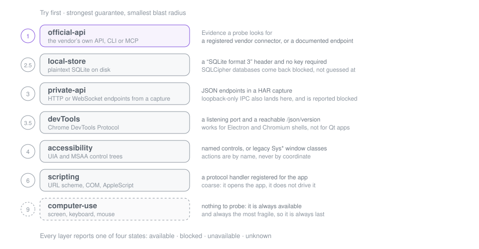
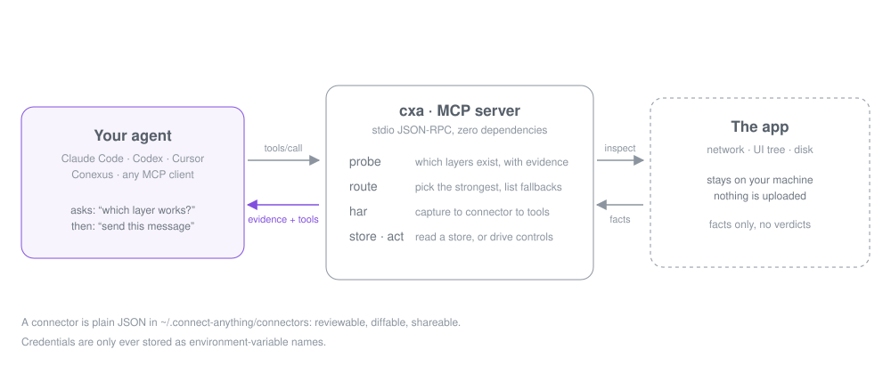

<div align="center">

**English** · [简体中文](docs/readme/README_zh.md)

# connect-anything: one layer below the pixels

### One MCP server that turns what an app already exposes into tools your agent can call.

**See a feature in an app. Give your agent the same one — through an interface that keeps working.**

[](https://github.com/Zhang-Dongfang/connect-anything/actions/workflows/ci.yml)
[](#project-status)
[](#what-you-can-connect)
[](#project-status)
[](#mcp-tools)
[](#use-it-as-a-skill-process-not-just-tools)
[](LICENSE)

**[Case studies](#case-studies) · [Architecture](docs/architecture.md) · [Roadmap](ROADMAP.md)**

[Quick start](#quick-start) · [How cxa works](#how-cxa-works) · [What you can connect](#what-you-can-connect) · [Prior art](#prior-art-and-where-this-differs) · [FAQ](#faq) · [Documentation](#documentation)

<code>npx -y github:Zhang-Dongfang/connect-anything probe CalculatorApp</code>

</div>

> [!IMPORTANT]
> Get connect-anything from [Zhang-Dongfang/connect-anything](https://github.com/Zhang-Dongfang/connect-anything).
> There is **no official npm package**: the name `connect-anything` on npm belongs to a different
> project, so `npx connect-anything` runs somebody else's code. Install from this repository
> (`npx -y github:Zhang-Dongfang/connect-anything`, a clone, or `node src/cli.js`).
> A similar repository name, a copied README, or a lookalike package does not make a download official.

<div align="center">

<br />



<br /><br />

<table aria-label="connect-anything community">
<tr>
<td align="center" width="300">
  <a href="https://github.com/Zhang-Dongfang/connect-anything/discussions">
    <strong>Ask in Discussions</strong>
  </a><br />
  <sub>“How do I…” · show and tell</sub>
</td>
<td align="center" width="300">
  <a href="https://github.com/Zhang-Dongfang/connect-anything/labels/good%20first%20issue">
    <strong>Pick a good first issue</strong>
  </a><br />
  <sub>Every one carries acceptance criteria</sub>
</td>
<td align="center" width="300">
  <a href="https://github.com/Zhang-Dongfang/connect-anything/issues">
    <strong>Report a blocked layer</strong>
  </a><br />
  <sub>A negative result is a result</sub>
</td>
</tr>
</table>

<br />

</div>

---
See a feature in an app that you want in your own product, or a task you want an agent to do inside
an app you already run. [REA](https://github.com/morluto/rea) answers *“how does this app work?”*, down
to the binary. connect-anything answers the next question: *“how do I get my agent to actually do the
thing in that app, and what is the cheapest route that will still work next month?”*

You export a capture, or point it at a running window, and it replies in the currency REA uses:
findings with evidence. Which layers does this app support? Which one should be tried first? What does
the connector look like once it is built? What is left when everything stronger is unavailable?

What makes it different from most automation is that it is allowed to say **no**. A layer that exists
but should not be pushed — an encrypted store with no key on disk, a window that exposes four named
controls and draws the rest, a loopback-only IPC channel — comes back as `blocked` with its reason,
and the agent is told to fall back instead of reaching for screenshots or for someone's decryption
tool. That refusal is a feature: it is the difference between an agent that reports what it cannot do
and one that quietly burns an account finding out.

It calls REA as a pinned, black-box CLI for static analysis of Electron and JavaScript apps, and owns
everything after that: probing, routing, connector specs, tool generation, credentials and health
checks. It is a companion, not a fork; a REA upgrade touches one file (`src/rea.js`).

## Quick start

### Install

Node.js 20 or newer, and nothing else: no runtime dependencies, no build step, no native module.

There is no npm package to install: `connect-anything` on npm belongs to another project, so **this
repository is the distribution**. Two ways in.

**In Claude Code: install it from the plugin marketplace.** This repository is its own marketplace
(`.claude-plugin/marketplace.json`) and the plugin ships both the skill and the MCP server:

```text
/plugin marketplace add Zhang-Dongfang/connect-anything
/plugin install connect-anything
```

That gives you the skill procedure and a `connect-anything` stdio server from the next session on -
no clone, no global install. The server entry uses `npx -y github:Zhang-Dongfang/connect-anything`,
so the first call fetches `main`; on Windows you may need the `cmd /c npx` wrapper shown below.

**Anywhere else: run it from git.** Each run fetches the current `main`:

```bash
npx -y github:Zhang-Dongfang/connect-anything --help
```

Or clone it and run it in place:

```bash
git clone https://github.com/Zhang-Dongfang/connect-anything
cd connect-anything
node src/cli.js --help
```

`cxa store` additionally needs Node 22.5 or newer, because it uses the built-in `node:sqlite` driver.
Every other command works on Node 20, and `cxa store` says exactly what it is missing rather than
falling over.

### Register it with your agent

Any MCP client that can start a stdio server works. For a git install, point the command at the
repository:

```json
{
  "mcpServers": {
    "connect-anything": {
      "command": "npx",
      "args": ["-y", "github:Zhang-Dongfang/connect-anything", "serve"]
    }
  }
}
```

On Windows, wrap it in the shell, because `npx` is a `.cmd` shim:

```json
{ "command": "cmd", "args": ["/c", "npx", "-y", "github:Zhang-Dongfang/connect-anything", "serve"] }
```

Then optionally hand the agent the procedure as well as the tools — see
[Use it as a Skill](#use-it-as-a-skill-process-not-just-tools). Restart the agent after changing its
MCP configuration.

### Other hosts

Every MCP host speaks the same stdio protocol; only the file and the key names differ. `cxa` writes
the shape each one reads:

```bash
cxa mcp-config claude --write   # .mcp.json                  mcpServers      (Claude Code, project)
cxa mcp-config cursor --write   # .cursor/mcp.json           mcpServers      (Cursor, project)
cxa mcp-config vscode --write   # .vscode/mcp.json           servers + "type": "stdio"
cxa mcp-config copilot --write  # .copilot/mcp-config.json   mcpServers      (VS Code Copilot, global)
cxa mcp-config codex --write    # .codex/config.toml         [mcp_servers.connect-anything]
cxa mcp-config codex            # print the entry instead of writing anything
cxa mcp-config --list           # every host name, with where it writes
```

The repository already ships `.mcp.json`, `.cursor/mcp.json`, `.vscode/mcp.json` and
`.codex/config.toml`, so a fresh checkout usually needs only a restart of the host. On Windows,
prefer the generator with `--write` over copying those files: only the generator knows to emit
`cmd.exe /d /s /c npx ...`, because Node cannot spawn the `npx.cmd` shim directly - `spawn("npx")`
fails with ENOENT, while `spawn("cmd.exe", ["/d", "/s", "/c", "npx", "--version"])` exits 0.
`--posix` forces the plain `npx` form for a config you mean to commit or share.

Codex needs neither a marketplace nor a clone:

```bash
codex mcp add connect-anything -- npx -y github:Zhang-Dongfang/connect-anything serve
codex mcp list     # connect-anything | npx | -y github:... serve | enabled
```

Cursor and VS Code read their project files when you open the folder, and Copilot's native config
is the same `mcpServers` shape at `~/.copilot/mcp-config.json`. Coding agents that read
[AGENTS.md](AGENTS.md) - Codex, Cursor, Copilot, Gemini CLI - get the procedure from there, the way
Claude Code gets it from the skill.

### Ask your agent

```text
Probe the Weixin desktop client with cxa, show me the evidence behind each layer,
and tell me the cheapest reliable way to send a message. If every layer is blocked,
say so and stop there — do not fall back to screenshots on your own.
```

Replace the app and the task with yours. A good answer names the layer it chose, the evidence behind
it, and what it deliberately did not try.

### Use the terminal

The same capabilities, without an agent in the middle:

```bash
cxa probe CalculatorApp                        # which layers does this app support?
cxa har capture.har --name myapp               # reverse a private API into MCP tools
cxa store "%LOCALAPPDATA%\NetEase\CloudMusic\NIM"   # read a local SQLite store, read-only
cxa act notepad --name "文本编辑器" --get-text  # drive named controls, no pixels
cxa list                                       # installed connectors and missing credentials
cxa serve                                      # the MCP server on stdio
```

### Keep it current

The project is pre-1.0 and moves: the connector format and the CLI can still change between minor
versions. `npx -y github:…` always runs the current `main`; a clone updates with `git pull`.

## How cxa works

Your agent asks a question, and cxa answers it by inspecting the app instead of guessing: it reads
the process list, the listening sockets, the accessibility tree, the on-disk store and any recorded
traffic. It returns findings with the evidence it used, plus a routing decision — one layer to use,
an ordered list of fallbacks, and the reasons a stronger layer was refused.

The agent then either explains what it found or calls the generated tool. Both paths go through the
same layer table, so a terminal session and an agent session never disagree about what is possible.



[Open the full-size figure](docs/assets/cxa-flow.svg).

Three invariants hold across every layer:

1. **Evidence or silence.** Every verdict carries the facts it was derived from, so it can be
   reproduced or argued with. `probe-win.ps1` collects facts; `probe.js` makes judgements — which is
   why the judgement rules are unit-tested on Linux CI against captured JSON fixtures.
2. **Credentials are names.** A connector stores the *name* of an environment variable, never the
   value. Nothing secret is written to `~/.connect-anything/`.
3. **`blocked` is a first-class state.** It is not “unknown”; it is “this is possible and we are
   refusing”, and it always ships with the reason.

## What you can connect

Each row is something the project has actually been run against on a real machine, or a layer whose
probe is covered by fixtures. The third column is what it needs from you, not a wish list.

| Target | What cxa returns | Requirements and command |
| --- | --- | --- |
| Web apps, and any HTTP surface you can record | Endpoint inventory, a connector, one tool per endpoint, path parameters and required fields inferred from the samples | A HAR from Chrome, Edge or Firefox: `cxa har capture.har --name myapp` |
| Electron and JavaScript apps | Candidate endpoints, modules and IPC boundaries from static analysis, then a capture to confirm which ones carry data | Node 20+, optional REA CLI; MCP tool `cxa_rea_analyze_app` |
| Encrypted request envelopes (NetEase weapi style) | A connector that keeps the encryption, flags which bodies were opaque in the capture, and exposes the tools anyway | `cxa har … --augment specs/netease.json` · [case study](docs/netease.md) |
| Desktop apps with real controls (Win32, WPF, UWP) | Named controls, the patterns each one exposes, and a verified state change after acting | Windows: `cxa probe <exe>` then `cxa act <exe>` |
| Legacy MSAA-only apps (`regedit`) | The exposed control classes, even when modern UIA shows almost nothing | Windows: `cxa probe regedit` |
| Self-drawn UI (Qt, Flutter, games) | A `blocked` accessibility verdict with the evidence — “computer use is the only path”, said out loud | Windows: `cxa probe <exe>` |
| Plaintext SQLite on disk | Tables, columns and read-only queries against the app's own data, no UI automation | Node 22.5+: `cxa store "<dir>" --tables` / `--sql "select …"` |
| Encrypted stores (SQLCipher, WeChat 4.x) | `blocked`, with the file count, the size and the reason — no key extraction attempted | `cxa probe <exe> --find-store "<hints>"` |
| Apps that only talk over loopback IPC | `blocked` private-api, with the listener inventory that proves it is not replayable | Windows: `cxa probe <exe>` |
| Mini-program runtimes inside a desktop app | A devTools verdict that says why CDP is unreachable rather than pretending it might work | Windows: `cxa probe <exe>` |
| URL schemes, COM, AppleScript | The scripting layer: it opens the app, and the verdict says that is all it does | Windows: `cxa probe <exe>` |
| Everything else | Computer use — always available, always last, and never chosen silently | Documented, not hidden: [architecture](docs/architecture.md#3-分层接入模型) |

What it deliberately does not do: extract keys from process memory, defeat anti-automation checks,
decrypt an encrypted store, or use a vendor's private credentials. Those are other products. When a
layer needs one of them, the answer is `blocked` and the project says so in public —
[the WeChat case study](docs/weixin.md) exists for exactly that reason.

Calling a private API may violate a service's terms even when the technique works. That is your call
to make, not something the tool can make for you.

### What a HAR actually is

HAR stands for **HTTP Archive**: the JSON log a browser keeps of every request it made. In Chrome,
Edge or Firefox: open DevTools, open the Network tab, do the task **once**, right-click,
*Save all as HAR with content*. That file is the raw material for `cxa har` — nothing more magical
than a recording of traffic.

```json
{ "log": { "entries": [ {
    "request":  { "method": "GET", "url": "https://app.example.com/api/v1/projects?limit=20",
                  "headers": [ { "name": "Authorization", "value": "Bearer ..." } ] },
    "response": { "status": 200, "content": { "mimeType": "application/json", "text": "[{\"id\":101}]" } }
} ] } }
```

What it gives you: real URLs, methods, headers, request and response bodies — the endpoint inventory a
connector is built from, with ids that can become path parameters.

What it does not give you: traffic that never went through that browser (native network stacks, IPC),
the plaintext inside an encrypted body (`params=…&encSecKey=…` stays opaque), or what a business error
means when the transport returned 200.

A HAR contains live cookies and tokens. Treat it like a password: `*.har` is gitignored here, and
captures with real account traffic must be scrubbed before they are shared.

## Case studies

Every number below came from a real run on this machine, including the ones that are disappointing.

### Weixin: a negative result, reported in full

`Weixin 4.1.15.13` on Windows — a Qt app that draws its own UI. The probe ran, the answer was *no*,
and the useful part is why:

| Layer | Status | Evidence |
| --- | --- | --- |
| official-api | unknown | no vendor API registered |
| private-api | **blocked** | 5 loopback-only IPC listeners |
| devTools | unavailable | mini-program runtime only, no remote debugging port |
| accessibility | **blocked** | `namedControls=4`; `Qt51514QWindowIcon`, `MMUIRenderSubWindowHW` |
| local-store | **blocked** | 24 SQLCipher databases, 1.05 GB, key absent from disk **and** memory |
| scripting | available | `weixin://`, deep link only |

Key recovery was tried honestly before being declared out of scope: `key_info.dat` is 180 bytes of
high-entropy data with no key in it; `ReadProcessMemory` reads 1041 MB in 2.2 s and finds none of the
classic WCDB `x'<key><salt>'` patterns; a Frida hook on `bcrypt!BCryptDeriveKeyPBKDF2` recorded zero
calls across 30 seconds of live use. That reproduces upstream issue wx-cli#89: WeChat 4.1.10+ no
longer caches the raw key. Going further means hooking SQLCipher internals — which this project does
not do.

**Verdict:** computer use is the only real way to drive this client, and the tool says so instead of
pretending otherwise. [Read the case study](docs/weixin.md).

### NetEase Cloud Music: an encrypted API, 8 of 10 tools live

The web player signs every request (`params` = AES, `encSecKey` = RSA), so replaying a capture
verbatim cannot work. One clickthrough produced 56 API requests; the generator turned them into a
connector and flagged which bodies were encrypted. With the weapi codec plus an authored spec, **8 of
10 tools return live data through MCP** — the other two report their real business error codes
(`-110`, `50000005`) rather than faking success.

```bash
cxa har captures/netease.har --name netease --host music.163.com --augment specs/netease.json
```

[Read the case study](docs/netease.md).

### Calculator and Notepad: pressing things without pixels

`cxa act` drives named UI Automation controls and re-reads the tree afterwards, so it can tell you
whether anything actually happened. Real output for `7 + 5 =`:

```
invoke Button "七" autoId=num7Button via Invoke
  verified: control tree changed (51A09A78511AB58C -> 48082FED60764893)
...
Text "显示为 12" autoId=CalculatorResults = "显示为 12"
```

Four rules make that safe enough to hand to an agent:

| Rule | Behaviour |
| --- | --- |
| Semantic only | `Invoke` / `Toggle` / `SelectionItem` / `Value`; `--click`, `--x`, `--y`, `--screenshot`, `--key` are refused with an explanation, not silently ignored |
| Dry run by default | `--invoke` and `--set-value` print the resolved target and pattern and do nothing without `--confirm` |
| Verify after acting | the tree is re-read; no change means `NOT verified` and a non-zero exit, never a claim of success |
| Self-drawn surfaces say so | a Qt or Flutter window with no patterns reports “computer use is the only path” |

Known limits: Windows only; UWP and hosted apps need `--window <title>` (or the foreground) because a
suspended app exposes an empty control tree. `regedit` works the other way round: modern UIA shows
nothing, but MSAA control classes (`SysTreeView32`, `SysListView32`, `Edit`) are right there.

If you use cxa on something interesting, open a
[Discussion](https://github.com/Zhang-Dongfang/connect-anything/discussions) with the target, your
question, the verdict and what you did next. Negative results are welcome; they are the most useful
thing in this README.

## Prior art and where this differs

This corner of the ecosystem is crowded, and pretending otherwise would be dishonest. Only projects
that were actually inspected are listed; absence here is not a claim of absence in the world.

| Project | What it does | How this differs |
| --- | --- | --- |
| [morluto/rea](https://github.com/morluto/rea) | agent-driven reverse engineering, down to native binaries | REA analyses; this project owns what happens after the analysis — routing, connectors, credentials, health |
| [alufers/mitmproxy2swagger](https://github.com/alufers/mitmproxy2swagger) | mitmproxy captures or HAR to OpenAPI 3.0 | this emits callable MCP tools; OpenAPI is a spec for other generators |
| [hydope/har2mcp](https://github.com/hydope/har2mcp) | HAR to a standalone MCP server, secrets in env vars | same conversion step, but it comes *after* a probe that decides whether to convert at all, with a local-store layer and a router on top |
| [microsoft/playwright-mcp](https://github.com/microsoft/playwright-mcp) | browser automation over accessibility snapshots | not replaced: `devTools` and `accessibility` are layers this router sends work to |
| [WeChat MCP/CLI projects](https://github.com/zwl467135974/wechat-cli) | decrypt the local store, or drive the UI with `wxauto` | cited as evidence in [docs/weixin.md](docs/weixin.md), not vendored; this project reports `blocked` instead of extracting keys |

## MCP tools

Six built-in tools plus one generated tool per observed endpoint:

| Tool | Purpose |
| --- | --- |
| `cxa_route` | pick the best layer for an app and say when computer use is unnecessary |
| `cxa_probe_app` | detect which layers a running desktop app supports, with the evidence |
| `cxa_generate_from_har` | reverse a capture into a connector; tools appear immediately (`tools/list_changed`) |
| `cxa_rea_analyze_app` | hand an Electron or JavaScript app to REA and extract candidate endpoints |
| `cxa_act` | drive a named control (dry run unless the caller passes `confirm: true`) |
| `cxa_list_connectors` | installed connectors, their layer, and which credentials are missing |
| `<app>__<tool>` | one generated tool per observed endpoint |

`cxa store` is CLI-only for now: reading a database is a deliberate, inspectable act, and it is on the
[roadmap](ROADMAP.md) to expose it as a tool with the same read-only guards.

## Use it as a Skill (process, not just tools)

MCP hands an agent tools. A Skill hands it the *procedure*: probe first, act on the best layer, capture
once, generate, verify, and stop when a layer is `blocked`. Both ship from this repository.

```bash
cxa skill                  # install into an existing host skills dir (~/.claude/skills, else ~/.codex/skills)
cxa skill --target <dir>   # install somewhere else
cxa skill --check          # validate the bundled skill (frontmatter, links, size)
```

`SKILL.md` is a roughly 100-line index; the three references load only when a task needs them:

| File | Loaded when |
| --- | --- |
| `SKILL.md` | always: the five steps, the layer status table, the guardrails |
| `reference/layers.md` | deciding what a probe verdict actually means |
| `reference/connector-spec.md` | authoring or repairing a connector or augment spec |
| `reference/policy.md` | a layer came back `blocked` and someone wants to push past it |

The division of labour matters: the Skill decides **whether and how** to automate, and refuses to
defeat a `blocked` layer; the MCP server (or the `cxa` CLI when no MCP host is available) performs the
calls. Installing the Skill does not create connectors for you — it stops the agent from reaching for
screenshots first.

## Connector spec

A connector is plain JSON in `~/.connect-anything/connectors/`, so it can be reviewed, diffed and
shared like any other source file:

```json
{ "name": "demo", "baseUrl": "https://app.example.com", "layer": "private-api",
  "auth": [{ "header": "authorization", "env": "CXA_DEMO_AUTHORIZATION" }],
  "tools": [{ "name": "post_projects_tasks", "method": "POST", "path": "/api/v1/projects/{project_id}/tasks",
              "pathParams": ["project_id"], "body": { "title": { "type": "string", "required": true } } }] }
```

A tool may also declare `codec` (`"weapi"` encrypts the body with NetEase-style AES+RSA instead of
sending JSON), `staticHeaders` (headers the API insists on, such as `referer`), `bodyDefaults` (applied
before caller arguments), `resultPath` (lift one JSON field into `data`), and `optional: true` on auth
entries that only unlock extra data.

Nothing about a connector is hidden: it is the audit trail of what an agent is allowed to call.

## FAQ

<details>
<summary><strong>Which agents can use connect-anything?</strong></summary>

Any MCP client that can launch a stdio server. Without one, the `cxa` CLI exposes the same
capabilities, minus the generated tools being callable from a chat.

</details>

<details>
<summary><strong>Is there an npm package?</strong></summary>

No, and this is deliberate: `connect-anything` on npm belongs to a different project, so
`npx connect-anything` would run somebody else's code. Install from
[this repository](https://github.com/Zhang-Dongfang/connect-anything) —
`npx -y github:Zhang-Dongfang/connect-anything …`, a clone, or `node src/cli.js`. If a package under
this project's name ever appears, it will only be announced here first.

</details>

<details>
<summary><strong>Do I need REA installed?</strong></summary>

No. REA is one optional tool for static analysis of Electron and JavaScript apps. Probing, routing,
capture-to-connector, local stores, accessibility actions and the MCP server work without it.

</details>

<details>
<summary><strong>Does it upload my app, my capture or my data?</strong></summary>

No. Analysis runs locally, captures stay on disk, and connectors reference environment-variable names.
What your agent does with the *results* is governed by your model provider's data policy, not by this
project.

</details>

<details>
<summary><strong>Where do credentials live?</strong></summary>

In your environment. A connector stores `CXA_<APP>_<HEADER>`, never the value. If the variable is
missing, the tool fails with the exact name to set instead of sending an unauthenticated request.

</details>

<details>
<summary><strong>Will it defeat anti-bot checks or decrypt an encrypted store?</strong></summary>

No — not “not yet”, no. That is the [policy boundary](docs/architecture.md#9-安全与合规边界): a layer
that requires it is reported `blocked` with its reason. If you have your own tool for that job, use it;
connect-anything will keep saying `blocked` and will not route around you.

</details>

<details>
<summary><strong>macOS and Linux?</strong></summary>

Everything that is not Windows-specific — capture to connector, the read-only store reader, the Skill,
`cxa list`, `cxa serve` — runs anywhere Node does. The desktop facts collector is Windows-only today;
AX and AT-SPI collectors are tracked as issues
[#3](https://github.com/Zhang-Dongfang/connect-anything/issues/3) and
[#4](https://github.com/Zhang-Dongfang/connect-anything/issues/4). The CLI says “Windows only” rather
than returning an empty verdict.

</details>

<details>
<summary><strong>What should I do if I hit a bug?</strong></summary>

Update first (`git pull`, or run the `npx` form again — it always fetches current `main`). Then retry
the same task. If it persists, open an issue with the target app and version, the command you ran, the
full output, and what you expected. A probe result that looks wrong is a bug worth reporting even if
the verdict was technically defensible.

</details>

## Project status

0.1.0, pre-1.0: the connector format and the CLI can still change between minor versions. What exists
today is accounted for, not promised:

- **104 tests**, all passing locally and on CI (Ubuntu and Windows, Node 20, 22 and 24).
- **The Skill validator** (``cxa skill --check``) refuses frontmatter that a host would silently drop.
- **Real probe runs** on `Weixin 4.1.15.13` and `regedit`, with the fixtures kept so the judgements are
  tested on Linux too.
- **Live NetEase Cloud Music tools** through MCP, including the two that fail honestly.
- **Zero runtime dependencies, no build step.** Windows only where it must be, and it says so.

## Documentation

- [Architecture](docs/architecture.md) — the layer model, module responsibilities, the three data
  flows, extension points and the policy boundary.
- [Weixin case study](docs/weixin.md) — a full negative result, and why reporting it is the useful
  outcome.
- [NetEase case study](docs/netease.md) — an encrypted API turned into working tools, including the
  parts that stayed broken.
- [SKILL.md](skills/connect-anything/SKILL.md) — the workflow handed to an agent.
- [Roadmap](ROADMAP.md) and [Contributing](CONTRIBUTING.md) — what comes next and where a change
  belongs.

Report vulnerabilities through [SECURITY.md](SECURITY.md), privately.

## Roadmap

Checked items are shipped and covered by tests; open items each link to an issue with acceptance
criteria in [ROADMAP.md](ROADMAP.md).

- [x] HAR → connector, zero-dependency stdio MCP server, layered router, REA bridge
- [x] Encrypted request envelopes (NetEase weapi: AES+RSA) plus authored `--augment` specs
- [x] Packaged as an Agent Skill (`SKILL.md` and progressive-disclosure `reference/`)
- [x] Windows probe and semantic `cxa act` (UIA), run against Weixin, Calculator and Notepad
- [x] Read-only local store reader (`cxa store`)
- [ ] macOS and Linux facts collectors (AX, AT-SPI) — issues #3 and #4
- [ ] Local recording proxy → HAR, for apps with no DevTools — issue #5
- [ ] Live CDP capture with session reuse; WebSocket, GraphQL and gRPC-web bodies
- [ ] Scripting providers (COM, AppleScript, D-Bus), self-healing connectors, a connector registry

## Responsible use

For interoperability with software and accounts you own or are authorised to automate. Calling a
private API may violate a service's terms even when the technique works; you are responsible for
compliance. Credentials stay in your environment, and a `blocked` verdict is not an invitation to
route around the tool.

## Contributing

Small pull requests are the norm here, and you do not need an issue first: docs, tests, fixtures and
small flags are reviewed as they arrive, and every pull request is labelled automatically.

- [Good first issues](https://github.com/Zhang-Dongfang/connect-anything/labels/good%20first%20issue)
  and [help wanted](https://github.com/Zhang-Dongfang/connect-anything/labels/help%20wanted) say where
  help is wanted, with acceptance criteria on each one.
- [CONTRIBUTING.md](CONTRIBUTING.md) has the dev setup, where a change belongs and the test rules;
  `npm run verify` is the whole gate.
- “How do I…” questions go to
  [Discussions](https://github.com/Zhang-Dongfang/connect-anything/discussions);
  [CODE_OF_CONDUCT.md](CODE_OF_CONDUCT.md) sets the expectations; security problems go through
  [SECURITY.md](SECURITY.md).

## License

[MIT](LICENSE). Not affiliated with REA, Tencent, NetEase or any other vendor whose software appears
in the case studies; their terms still apply to your use of their services.