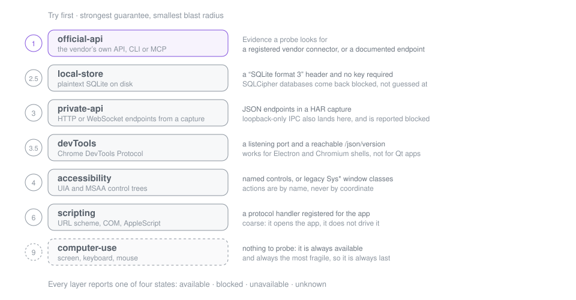
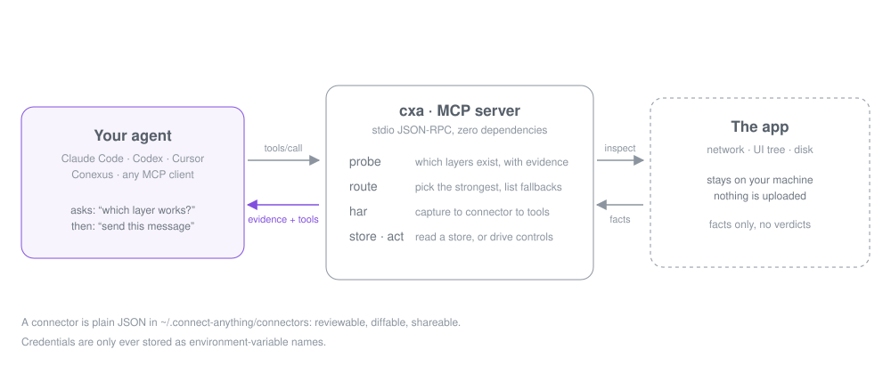

<div align="center">

[English](../../README.md) · **简体中文**

# connect-anything：比像素低一层

### 一个 MCP 服务器：把应用已经暴露出来的能力，变成 Agent 能直接调用的工具。

**看到某个应用里的功能，就给你的 Agent 一份同样的——走一条下个月还能用的接口。**

[](https://github.com/Zhang-Dongfang/connect-anything/actions/workflows/ci.yml)
[](#项目状态)
[](#能接什么)
[](#项目状态)
[](#mcp-工具)
[](#作为-skill-使用)
[](../../LICENSE)

**[案例](#案例) · [架构](../architecture.md) · [路线图](../../ROADMAP.md)**

[快速开始](#快速开始) · [它怎么工作](#它怎么工作) · [能接什么](#能接什么) · [同类项目](#同类项目与差异) · [FAQ](#faq) · [文档](#文档)

<code>npx -y github:Zhang-Dongfang/connect-anything probe CalculatorApp</code>

</div>

> [!IMPORTANT]
> 请从 [Zhang-Dongfang/connect-anything](https://github.com/Zhang-Dongfang/connect-anything) 获取。
> **没有官方 npm 包**：npm 上的 `connect-anything` 属于另一个项目，`npx connect-anything` 跑的是别人的代码。
> 请从本仓库安装（`npx -y github:Zhang-Dongfang/connect-anything`、git clone，或 `node src/cli.js`）。
> 仓库同名、README 被抄、包名相似，都不能说明下载来源是官方的。

<div align="center">

<br />



<br /><br />

<table aria-label="connect-anything 社区">
<tr>
<td align="center" width="300">
  <a href="https://github.com/Zhang-Dongfang/connect-anything/discussions">
    <strong>去 Discussions 提问</strong>
  </a><br />
  <sub>“这个怎么弄……” · 晒成果</sub>
</td>
<td align="center" width="300">
  <a href="https://github.com/Zhang-Dongfang/connect-anything/labels/good%20first%20issue">
    <strong>挑一个新手 issue</strong>
  </a><br />
  <sub>每一个都写了验收标准</sub>
</td>
<td align="center" width="300">
  <a href="https://github.com/Zhang-Dongfang/connect-anything/issues">
    <strong>报告一个 blocked 的层</strong>
  </a><br />
  <sub>负面结论也是结论</sub>
</td>
</tr>
</table>

<br />

</div>

---

看到一个应用里有一个你想要的功能，或者想让 Agent 在一个你已经在用的应用里做一件事。
[REA](https://github.com/morluto/rea) 回答的是“这个应用是**怎么实现的**”，一直钻到二进制。
connect-anything 接着回答下一个问题：“我到底怎么让 Agent 真的把它做出来，而且哪条路最便宜、
下个月还不用重做？”

你导出一份抓包，或者把一个正在跑的窗口指给它，它用的也是 REA 那套货币：**带证据的结论**。
这个应用支持哪几层？应该先试哪一层？连接器建出来长什么样？更强的层全部不可用时，还剩下什么？

它和大多数自动化的区别在于：**它被允许说“不”**。一个存在但不该强推的层——加密存储且密钥不在磁盘上、
窗口只暴露四个命名控件其余全靠自绘、只有回环 IPC 通道——会带着原因返回 `blocked`，
然后叫 Agent 降级，而不是去拍屏，也不是去拿别人的解密工具。这种拒绝是特性：它决定了你的 Agent 是
**如实报告自己做不了**，还是**悄悄地烧掉一个账号来试**。

它把 REA 当成固定版本的黑盒 CLI 来调用，做 Electron / JavaScript 应用的静态分析；分析之后的一切都归它：
探测、选层、连接器规格、工具生成、凭据、健康检查。它是**伴生项目，不是 fork**；REA 升级只动一个文件
（`src/rea.js`）。

## 快速开始

### 安装

Node.js 20 或更新，其它什么都不需要：无运行时依赖、无构建步骤、无原生模块。

```bash
git clone https://github.com/Zhang-Dongfang/connect-anything
cd connect-anything
node src/cli.js --help
```

或者不 clone，直接从 git 跑。每次执行都会拉当前的 `main`：

```bash
npx -y github:Zhang-Dongfang/connect-anything --help
```

`cxa store` 另外需要 Node 22.5+，因为它用的是内置的 `node:sqlite`。其它命令在 Node 20 上都能跑，
`cxa store` 在旧 Node 上会明确告诉你缺什么，而不是默默砦掉。

### 注册到你的 Agent

任何能启动 stdio 服务器的 MCP 客户端都行。用 git 安装时，把命令指向仓库：

```json
{
  "mcpServers": {
    "connect-anything": {
      "command": "npx",
      "args": ["-y", "github:Zhang-Dongfang/connect-anything", "serve"]
    }
  }
}
```

Windows 上要用 shell 包一层，因为 `npx` 是 `.cmd` 垫片：

```json
{ "command": "cmd", "args": ["/c", "npx", "-y", "github:Zhang-Dongfang/connect-anything", "serve"] }
```

然后可选地把**流程**也交给 Agent，而不只是工具——见
[作为 Skill 使用](#作为-skill-使用)。改完 MCP 配置记得重启 Agent。

### 让 Agent 动手

```text
用 cxa 探测一下微信桌面客户端，把每一层的证据给我看，然后告诉我发一条消息最便宜又可靠的路。
如果所有层都是 blocked，就直接说做不了，不要自作主张去拍屏。
```

把应用和任务换成你自己的。一个好的回答会告诉你它选了哪一层、依据是什么、以及它**故意没试**什么。

### 用终端

没有 Agent 也能用，能力一样：

```bash
cxa probe CalculatorApp                        # 这个应用支持哪几层？
cxa har capture.har --name myapp               # 把私有接口逆向成 MCP 工具
cxa store "%LOCALAPPDATA%\NetEase\CloudMusic\NIM"   # 只读读取本地 SQLite
cxa act notepad --name "文本编辑器" --get-text  # 按名字驱动控件，不用像素
cxa list                                       # 已装连接器 + 缺哪个凭据
cxa serve                                      # 在 stdio 上跑 MCP 服务器
```

### 保持更新

项目是 pre-1.0，变化很快：连接器格式和 CLI 在小版本之间都可能改。`npx -y github:…`
每次都跑当前 `main`；clone 的用 `git pull` 更新。

## 它怎么工作

Agent 问一个问题，cxa 不是靠猜，而是去**看**：进程列表、监听端口、无障碍树、磁盘上的数据库、
以及任何已录的流量。返回的是带证据的结论，加上一个路由决定——要用哪一层、备选顺序是什么、
更强的层是因为什么被拒绝的。

然后 Agent 要么解释它看到的东西，要么直接调生成的工具。两条路走的是同一张层表，所以终端里能做的
和 Agent 里能做的永远不会不一致。



[看大图](../assets/cxa-flow.svg)。

有三条不变式贯穿所有层：

1. **要么给证据，要么闭嘴。** 每个判定都带着它的依据，可复现、可反驳。`probe-win.ps1` 只采集事实，
   `probe.js` 才做判断——所以判定规则能在 Linux CI 上用抓下来的 JSON fixture 跑单测。
2. **凭据只是名字。** 连接器里存的是环境变量的**名字**，从来不是值。`~/.connect-anything/`
   里不会出现任何机密。
3. **`blocked` 是一等状态。** 它不是“不知道”，而是“做得到，但我们不做”，而且永远附上原因。

## 能接什么

表中每一行都是真机上实际跑过的，或者是探测逻辑有 fixture 覆盖的。第三列写的是它**需要你提供什么**，
不是愿望清单。

| 目标 | cxa 给你什么 | 需要什么 · 命令 |
| --- | --- | --- |
| 网页应用，以及任何能被录下来的 HTTP 面 | 端点清单、连接器、每个端点一个工具；路径参数与必填字段从样本里推导 | 一份 Chrome / Edge / Firefox 的 HAR：`cxa har capture.har --name myapp` |
| Electron / JavaScript 应用 | 静态分析得到的候选端点、模块与 IPC 边界，再用抓包确认哪几条真的带数据 | Node 20+，可选 REA CLI；MCP 工具 `cxa_rea_analyze_app` |
| 加密请求体（网易云 weapi 那种） | 保留加密的连接器；标出哪些请求体在抓包里是不透明的，但工具照旧可用 | `cxa har … --augment specs/netease.json` · [案例](../netease.md) |
| 真有控件的桌面应用（Win32 / WPF / UWP） | 命名控件、每个控件支持的模式、动作后**可验证**的状态变化 | Windows：`cxa probe <exe>`，然后 `cxa act <exe>` |
| 只剩 MSAA 的老应用（`regedit`） | 暴露出来的控件类，即使现代 UIA 里几乎什么都看不到 | Windows：`cxa probe regedit` |
| 自绘 UI（Qt / Flutter / 游戏） | 带证据的 `blocked` 无障碍结论——“只剩屏幕操作”这句话会明确说出来 | Windows：`cxa probe <exe>` |
| 磁盘上的明文 SQLite | 表、列，以及对应用自己数据的只读查询，不需要 UI 自动化 | Node 22.5+：`cxa store "<dir>" --tables` / `--sql "select …"` |
| 加密存储（SQLCipher、微信 4.x） | `blocked`，附文件数、体积和原因；不尝试取密钥 | `cxa probe <exe> --find-store "<线索>"` |
| 只走回环 IPC 的应用 | `blocked` 的 private-api，附上证明它不可重放的监听清单 | Windows：`cxa probe <exe>` |
| 桌面应用里的小程序运行时 | 一个说清楚“为什么连不上 CDP”的 devTools 结论，而不是“也许可以” | Windows：`cxa probe <exe>` |
| URL 协议、COM、AppleScript | 脚本层：它能拉起应用，判定也会说“就只有这么多” | Windows：`cxa probe <exe>` |
| 其它一切 | 屏幕操作——永远可用，永远最后，且从不神秘选择 | 写在明处，不藏：[架构](../architecture.md#3-分层接入模型) |

它**故意不做**的事：从进程内存里抠密钥、绕过反自动化风控、解密加密存储、使用厂商的私有凭据。
那是别的产品。当某一层需要这些时，答案就是 `blocked`，而且写在公开文档里——
[微信案例](../weixin.md) 存在的原因就是这个。

即使技术上行得通，调用私有接口也可能违反服务条款。这是你要做的判断，工具替不了你。

### HAR 到底是什么

HAR 就是 **HTTP Archive**：浏览器的每个请求都会被记进一份 JSON 日志。Chrome / Edge / Firefox 里：
开 DevTools，切到 Network，把任务**只做一次**，右键，*Save all as HAR with content*。
这份文件就是 `cxa har` 的原料——不比一份流量录像神秘多少。

```json
{ "log": { "entries": [ {
    "request":  { "method": "GET", "url": "https://app.example.com/api/v1/projects?limit=20",
                  "headers": [ { "name": "Authorization", "value": "Bearer ..." } ] },
    "response": { "status": 200, "content": { "mimeType": "application/json", "text": "[{\"id\":101}]" } }
} ] } }
```

它给你：真实的 URL、方法、头、请求与响应体——也就是建连接器需要的端点清单，
里面的 id 可以变成路径参数。

它不会给你：从来没经过那个浏览器的流量（原生网络栈、IPC）、加密请求体里的明文
（`params=…&encSecKey=…` 依旧不透明）、以及传输层返回 200 时业务错误到底是什么意思。

HAR 里有活的 Cookie 和 token，当密码处理：`*.har` 在本仓库是 gitignore 的，
带真实账号流量的抓包共享前必须脱敏。

## 案例

下面每个数字都来自本机真实运行，包括那些不好看的。

### 微信：一份完整的负面结论

Windows 上的 `Weixin 4.1.15.13`——一个自己画 UI 的 Qt 应用。探测跑了，答案是**不行**，
真正有用的部分是为什么：

| 层 | 状态 | 证据 |
| --- | --- | --- |
| official-api | unknown | 没有注册任何厂商 API |
| private-api | **blocked** | 5 个只监听回环的 IPC 端口 |
| devTools | unavailable | 只有小程序运行时，没有远程调试端口 |
| accessibility | **blocked** | `namedControls=4`；`Qt51514QWindowIcon`、`MMUIRenderSubWindowHW` |
| local-store | **blocked** | 24 个 SQLCipher 库，1.05 GB，密钥磁盘上没有、内存里也没有 |
| scripting | available | `weixin://`，只能拉起应用 |

在宣布“超出范围”之前，取密钥这件事是被如实试过的：`key_info.dat` 是 180 字节高熵数据，里面没有密钥；
`ReadProcessMemory` 能在 2.2 秒内读完 1041 MB，找不到经典的 WCDB `x'<key><salt>'` 特征；
在 `bcrypt!BCryptDeriveKeyPBKDF2` 上挂的 Frida 钩子，30 秒真人使用里**一次都没被调**。
这复现了上游 wx-cli#89：微信 4.1.10+ 不再把原始密钥缓存在进程里。再往下就是钩 SQLCipher 内部——
本项目不做。

**结论：** 屏幕操作是唯一真正能驱这个客户端的路，工具就这么说，而不是假装还有别的。
[读完整案例](../weixin.md)。

### 网易云音乐：加密接口，10 个工具 8 个可用

网页版给每个请求签名（`params` 走 AES，`encSecKey` 走 RSA），所以原样重放抓包不可能成功。
一次点击流程产生了 56 个 API 请求；生成器把它们变成连接器，并标出哪些请求体是加密的。
加上 weapi 编解码和人工规格后，**10 个工具里有 8 个能通过 MCP 返回真实数据**，剩下两个如实返回
它们的业务错误码（`-110`、`50000005`），而不是假装成功。

```bash
cxa har captures/netease.har --name netease --host music.163.com --augment specs/netease.json
```

[读完整案例](../netease.md)。

### 计算器与记事本：不用像素按按钮

`cxa act` 只驱动**命名**的 UI Automation 控件，动作之后重读一遍控件树，所以它能告诉你到底有没有生效。
`7 + 5 =` 的真实输出：

```
invoke Button "七" autoId=num7Button via Invoke
  verified: control tree changed (51A09A78511AB58C -> 48082FED60764893)
...
Text "显示为 12" autoId=CalculatorResults = "显示为 12"
```

四条规则让它安全到可以交给 Agent：

| 规则 | 行为 |
| --- | --- |
| 只用语义 | `Invoke` / `Toggle` / `SelectionItem` / `Value`；`--click`、`--x`、`--y`、`--screenshot`、`--key` 会被拒绝并给出理由，而不是默默忽略 |
| 默认空跑 | `--invoke` 和 `--set-value` 只打印解析出的目标和模式，不给 `--confirm` 就不动手 |
| 动完要验 | 重读控件树；没变化就是 `NOT verified` 并以非零退出，而不是自称成功 |
| 自绘就说自绘 | 没有模式的 Qt / Flutter 窗口，结论是“只剩屏幕操作” |

已知限制：只支持 Windows；UWP 和被托管的窗口要加 `--window <标题>`（或让它在前台），
因为被挂起的应用暴露的是空控件树。`regedit` 正好相反：现代 UIA 里什么都看不到，
但 MSAA 的控件类（`SysTreeView32`、`SysListView32`、`Edit`）就在那儿。

如果你用 cxa 做了点有趣的事，欢迎去
[Discussions](https://github.com/Zhang-Dongfang/connect-anything/discussions)
写清楚目标、你的问题、判定结果和下一步。**负面结论一样欢迎**，它才是这份 README 里最有用的东西。

## 同类项目与差异

这一片生态很挤，假装不挤才是不诚实。下面只列真正看过源码或文档的项目；
这里没出现的，不代表世界上没有。

| 项目 | 它做什么 | 差异 |
| --- | --- | --- |
| [morluto/rea](https://github.com/morluto/rea) | Agent 驱动的逆向，一直做到原生二进制 | REA 做分析；本项目负责分析之后的一切：选层、连接器、凭据、健康检查 |
| [alufers/mitmproxy2swagger](https://github.com/alufers/mitmproxy2swagger) | mitmproxy 抓包或 HAR → OpenAPI 3.0 | 本项输出的是可调用的 MCP 工具；OpenAPI 是给其它生成器用的规格 |
| [hydope/har2mcp](https://github.com/hydope/har2mcp) | HAR → 独立 MCP 服务器，密钥放环境变量 | 同样的转换步骤，但在一次探测**之后**（先判断该不该转），上面还有本地库层和路由器 |
| [microsoft/playwright-mcp](https://github.com/microsoft/playwright-mcp) | 基于无障碍快照的浏览器自动化 | 没被替代：`devTools` 和 `accessibility` 是本路由器会分发任务的两层 |
| [微信 MCP/CLI 项目](https://github.com/zwl467135974/wechat-cli) | 解本地库，或用 `wxauto` 驱动 UI | 在 [docs/weixin.md](../weixin.md) 里被当证据引用，不内置；本项目报 `blocked` 而不取密钥 |

## MCP 工具

六个内置工具，加上每个观测到的端点生成的一个工具：

| 工具 | 用途 |
| --- | --- |
| `cxa_route` | 为某个应用选出最好的一层，并说明什么时候不需要屏幕操作 |
| `cxa_probe_app` | 探测运行中的桌面应用支持哪几层，附证据 |
| `cxa_generate_from_har` | 把抓包逆向成连接器；工具立即出现（`tools/list_changed`） |
| `cxa_rea_analyze_app` | 把 Electron / JavaScript 应用交给 REA，抽出候选端点 |
| `cxa_act` | 驱动一个命名控件（不传 `confirm: true` 就是空跑） |
| `cxa_list_connectors` | 已装连接器、所在层、缺哪个凭据 |
| `<app>__<tool>` | 每个观测到的端点一个生成工具 |

`cxa store` 目前只在 CLI 里：读数据库应该是一个**看得见、审得了**的动作，
把它做成同样带只读护栏的工具已经列入 [路线图](../../ROADMAP.md)。

## 作为 Skill 使用

给流程，不只给工具。MCP 给 Agent **工具**，Skill 给它**步骤**：先探测，在最好的一层上动手，
只抓一次包，生成，验证，碰到 `blocked` 就停。两样东西都从本仓库发。

```bash
cxa skill                  # 装进已有的宿主 skills 目录（~/.claude/skills，否则 ~/.codex/skills）
cxa skill --target <dir>   # 装到别处
cxa skill --check          # 校验内置 skill（frontmatter、链接、体积）
```

`SKILL.md` 是大约一百行的索引，三份 reference 只在用到时才加载：

| 文件 | 什么时候加载 |
| --- | --- |
| `SKILL.md` | 总是：五个步骤、层状态表、护栏 |
| `reference/layers.md` | 判断一个探测结论到底意味着什么 |
| `reference/connector-spec.md` | 写或修连接器 / augment 规格 |
| `reference/policy.md` | 某层返回了 `blocked`，有人想推过去 |

分工很重要：Skill 决定**要不要、怎么**自动化，并拒绝绕开 `blocked` 的层；MCP 服务器
（或没有 MCP 宿主时的 `cxa` CLI）负责真正发请求。装 Skill 不会帮你建连接器，
它的作用是让 Agent 别一上来就拍屏。

## 连接器规格

连接器就是一个 JSON 文件，放在 `~/.connect-anything/connectors/`，所以它和普通源代码一样
可以审阅、diff、共享：

```json
{ "name": "demo", "baseUrl": "https://app.example.com", "layer": "private-api",
  "auth": [{ "header": "authorization", "env": "CXA_DEMO_AUTHORIZATION" }],
  "tools": [{ "name": "post_projects_tasks", "method": "POST", "path": "/api/v1/projects/{project_id}/tasks",
              "pathParams": ["project_id"], "body": { "title": { "type": "string", "required": true } } }] }
```

单个工具还可以声明 `codec`（`"weapi"` 会用网易云那套 AES+RSA 加密请求体，而不是发 JSON）、
`staticHeaders`（接口必须的头，例如 `referer`）、`bodyDefaults`（在调用方参数之前应用）、
`resultPath`（把一个 JSON 字段提升到 `data`），以及 `optional: true`（只解锁额外数据的凭据）。

连接器里没有任何黑箱：它就是“这个 Agent 被允许调什么”的审计记录。

## FAQ

<details>
<summary><strong>哪些 Agent 能用？</strong></summary>

任何能启动 stdio 服务器的 MCP 客户端。没有 MCP 宿主时，`cxa` CLI 提供同样的能力，
只是生成的工具没法在对话里直接调。

</details>

<details>
<summary><strong>有 npm 包吗？</strong></summary>

没有，而且是故意的：npm 上的 `connect-anything` 属于另一个项目，`npx connect-anything`
会跑别人的代码。请从[本仓库](https://github.com/Zhang-Dongfang/connect-anything)安装——
`npx -y github:Zhang-Dongfang/connect-anything …`、git clone，或 `node src/cli.js`。
如果有一天真的有了包，也只会先在这里公布。

</details>

<details>
<summary><strong>需要先装 REA 吗？</strong></summary>

不需要。REA 只是 Electron / JavaScript 静态分析的一个可选工具。探测、选层、抓包转连接器、
本地库、无障碍动作和 MCP 服务器都不需要它。

</details>

<details>
<summary><strong>会上传我的应用、抓包或数据吗？</strong></summary>

不会。分析在本地跑，抓包留在磁盘，连接器里只有环境变量名。你的 Agent 拿到的**结果**怎么处理，
归你用的模型服务的隐私政策管，不归本项目管。

</details>

<details>
<summary><strong>凭据存在哪？</strong></summary>

在你的环境里。连接器只存 `CXA_<APP>_<HEADER>`，不存值。变量缺失时，工具会直接报出要设哪个名字，
而不是发一个未认证的请求出去。

</details>

<details>
<summary><strong>它会绕过反自动化风控，或解密加密存储吗？</strong></summary>

不会——不是“暂时不会”，是不会。这就是[策略边界](../architecture.md#9-安全与合规边界)：
需要这些的层一律报 `blocked` 并附原因。你有自己的工具就用你自己的；
connect-anything 会继续说 `blocked`，不会绕开你。

</details>

<details>
<summary><strong>macOS 和 Linux 呢？</strong></summary>

所有非 Windows 特有的部分——抓包转连接器、只读库读取、Skill、`cxa list`、`cxa serve`——
只要有 Node 就能跑。桌面事实采集目前只有 Windows；AX 和 AT-SPI 采集器在
[#3](https://github.com/Zhang-Dongfang/connect-anything/issues/3) 和
[#4](https://github.com/Zhang-Dongfang/connect-anything/issues/4) 里。CLI 会直接说“只支持 Windows”，
而不是返回一个空结论。

</details>

<details>
<summary><strong>碰到 bug 了怎么办？</strong></summary>

先更新（`git pull`，或重新跑一次 `npx` 形式——它总是拉当前 `main`），然后用同样的任务重试。
如果还在，请开 issue，写上目标应用与版本、跑的命令、完整输出，以及你期望的结果。
一个看起来不对的探测结论也是 bug，哪怕它的结论“技术上说得通”。

</details>

## 项目状态

0.1.0，pre-1.0：连接器格式和 CLI 在小版本之间都可能变。今天存在的都是算得清的，不是许愿的：

- **95 个测试**，本地与 CI 全绿（Ubuntu 与 Windows，Node 20 / 22 / 24）。
- **Skill 校验器**（`cxa skill --check`）会拒绝宿主会默默丢弃的 frontmatter。
- **真机探测**：`Weixin 4.1.15.13` 与 `regedit`，fixture 全部保留，所以判定逻辑在 Linux 上也有单测。
- **网易云音乐工具实测**：通过 MCP 真实返数据，包括那两个如实失败的。
- **零运行时依赖、无构建步骤。** 必须 Windows 的地方就明说。

## 文档

- [架构](../architecture.md)——分层模型、模块职责、三条主数据流、扩展点与策略边界。
- [微信案例](../weixin.md)——一份完整的负面结论，以及为什么把它写出来才是有用的。
- [网易云音乐案例](../netease.md)——加密接口怎么变成能用的工具，包括没修好的部分。
- [SKILL.md](../../skills/connect-anything/SKILL.md)——交给 Agent 的工作流程。
- [路线图](../../ROADMAP.md) 与 [参与贡献](../../CONTRIBUTING.md)——接下来做什么、改动该放哪。

安全问题请走 [SECURITY.md](../../SECURITY.md)，私下报。

## 路线图

打勾的已交付且有测试覆盖；未完成的在 [ROADMAP.md](../../ROADMAP.md) 里逐条链到带验收标准的 issue。

- [x] HAR → 连接器、零依赖 stdio MCP 服务器、分层路由器、REA 桥
- [x] 加密请求体（网易云 weapi：AES+RSA）与人工 `--augment` 规格
- [x] 封装成 Agent Skill（`SKILL.md` + 渐进披露的 `reference/`）
- [x] Windows 探测与语义 `cxa act`（UIA），已在微信、计算器、记事本上跑过
- [x] 只读本地库读取（`cxa store`）
- [ ] macOS / Linux 事实采集（AX / AT-SPI）——issue #3 与 #4
- [ ] 本地录制代理 → HAR，服务没有 DevTools 的应用——issue #5
- [ ] 带会话复用的 CDP 实时捕获；WebSocket / GraphQL / gRPC-web 请求体
- [ ] 脚本层提供方（COM / AppleScript / D-Bus）、自修复连接器、连接器注册表

## 负责任地使用

用于你拥有或已获授权自动化的软件与账号。即使技术上行得通，调用私有接口也可能违反服务条款；
合规与否由你负责。凭据留在你的环境里，`blocked` 不是绕过去的邀请。

## 参与贡献

这里习惯是小 PR，不需要先开 issue：文档、测试、fixture、小开关，来了就审，
每个 PR 都会自动打标并有人应。

- [新手 issue](https://github.com/Zhang-Dongfang/connect-anything/labels/good%20first%20issue) 与
  [help wanted](https://github.com/Zhang-Dongfang/connect-anything/labels/help%20wanted) 写清了缺什么，
  每个都带验收标准。
- [CONTRIBUTING.md](../../CONTRIBUTING.md) 有开发环境、改动该放哪、以及测试规则；
  `npm run verify` 就是全部门禁。
- “这个怎么弄……”去 [Discussions](https://github.com/Zhang-Dongfang/connect-anything/discussions)；
  [CODE_OF_CONDUCT.md](../../CODE_OF_CONDUCT.md) 写了行为期待；安全问题走
  [SECURITY.md](../../SECURITY.md)。

## 许可证

[MIT](../../LICENSE)。与 REA、腾讯、网易以及案例中出现的任何厂商都没有关联；
你使用它们的服务仍然受它们自己的条款约束。